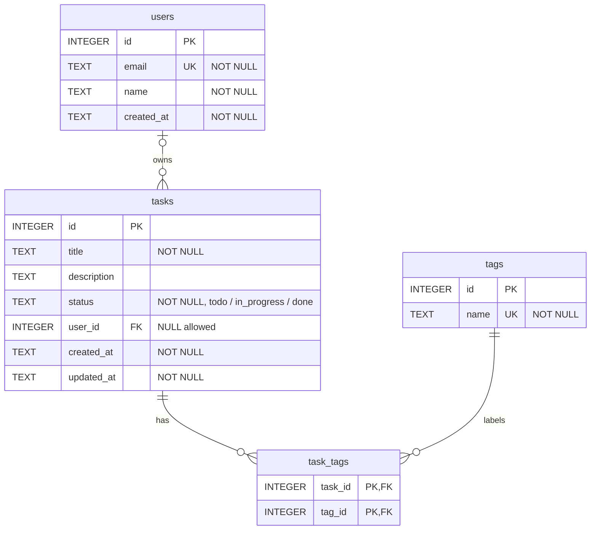

# M06 — SQL Fundamentals with SQLite

**Module M06 · Week 3 · Days 1-2 · about 3 hours**

Design the database behind the Task API, write the SQL yourself before an ORM hides it, check your work with 24 graded query exercises, and see a SQL injection attack succeed and then fail.

## Overview & time plan

**Builds on:** M05. You need the `node-js-training` repo with TypeScript set up (`npm run typecheck` is clean), and Node.js 24. Everything you write here goes into that same repo, on `main`, with the add, commit and push steps you know. This module does not change the Task API. (The word "module" on this page means the course lessons, M01 to M10.)

The Task API from M05 keeps its tasks in memory, so they vanish when the server stops. A real API keeps them in a **database**. In M07 you will use **Prisma**, a tool that writes the SQL for you. To use a tool like that well, and to find out why a query is slow or wrong, you need to know the SQL underneath. So this module comes first: you write the SQL yourself.

You will:

- design a small **relational schema**: `users`, `tasks`, `tags` and `task_tags`, the data the Task API needs;
- create and fill it in **SQLite**, a database that lives in one file and needs no server;
- answer **24 graded query exercises** (filtering, sorting, pagination, joins, aggregates, subqueries), and a script marks your answers;
- see an **index** change a query plan, and a **transaction** undo changes;
- attack a query with **SQL injection**, then block the attack with parameters;
- draw the schema as a **Mermaid diagram** in your README.

1. The relational model, SQLite and the schema design: 25 min
2. Create and seed the database: 20 min
3. Reading and changing data: 20 min
4. Joins, aggregates and subqueries: 25 min
5. Exercise set: 24 graded queries: 40 min
6. Indexes, EXPLAIN QUERY PLAN and transactions: 20 min
7. SQL injection and the parameterised fix: 15 min
8. The Mermaid ERD: 10 min
9. Check your understanding: 5 min

This page moves quickly. Type the SQL in sections 1 to 4 yourself where you can. The seed data (section 2) and the checker script (section 5) you may paste. Run every step, and compare with the *You should see* box. A note on versions: the outputs here come from SQLite 3.54 on Linux. An older SQLite prints the same results, but its tables and error messages can be laid out a little differently. If anything else differs, check [Troubleshooting](#troubleshooting).

## 1. The relational model, SQLite and the schema design (25 min)

### 1.1 Tables, keys and relationships

A **relational database** keeps data in **tables**. A table has **columns** (the fields) and **rows** (the records). Two kinds of key tie tables together:

- A **primary key** is a column (or columns) whose value is different in every row, so it names one row: `tasks.id`.
- A **foreign key** is a column that holds the primary key of a row in another table, so it points to that row: `tasks.user_id` points to `users.id`. The database can refuse a value that points to nothing.

There are three kinds of relationship between tables:

| Relationship | Meaning | How it is stored | Example here |
| --- | --- | --- | --- |
| **1:1** | One row matches at most one row in another table | A foreign key that is also `UNIQUE` | A user and a profile (not used in this module) |
| **1:N** (one to many) | One row matches many rows in another table | A foreign key on the "many" side | One user has many tasks: `tasks.user_id` |
| **M:N** (many to many) | Many rows match many rows | A **junction table** holding two foreign keys | A task has many tags, and a tag marks many tasks: `task_tags` |

An M:N relationship cannot live in either table: a task with three tags would need three tag columns, and a tag used by many tasks would need many task columns. The answer is a third table, the **junction table**, with one row for every (task, tag) pair. Its primary key is the *pair*, so the same tag cannot be added to the same task twice.

**Normalisation** is the habit of storing each fact once. In short: every column holds one value (first normal form), every column depends on the whole key (second), and no column depends on another non-key column (third). In practice it means: do not store a user's name inside every task, store a `user_id` and look the name up. Then renaming a user changes one row.

### 1.2 The schema you will build

| Table | Columns | Notes |
| --- | --- | --- |
| `users` | `id`, `email`, `name`, `created_at` | `email` is unique |
| `tasks` | `id`, `title`, `description`, `status`, `user_id`, `created_at`, `updated_at` | `status` is `todo`, `in_progress` or `done`. `user_id` may be empty: a task can be unassigned |
| `tags` | `id`, `name` | `name` is unique |
| `task_tags` | `task_id`, `tag_id` | The junction table. Its primary key is the pair |

`tasks` has the same fields as the Task type from M04, plus the owner. The relationships are: one user has many tasks (1:N), and tasks and tags are many to many through `task_tags`.

### 1.3 Install the sqlite3 command line

**SQLite** is a database in a single file. There is no server to start: a program opens the file and reads it. You will use its command-line shell, `sqlite3`. (A free graphical tool, DB Browser for SQLite, does the same job. This page uses the command line, so that every step is a command you can copy.)

#### Windows

Open a new Git Bash window and check whether it is already installed:

```bash
sqlite3 --version
```

If you get `command not found`, install it with the Windows package manager and open a **new** terminal afterwards:

```bash
winget install SQLite.SQLite
```

If `winget` does not find it, download **sqlite-tools-win-x64** from [sqlite.org/download.html](https://www.sqlite.org/download.html), unzip it somewhere, and add that folder to your `PATH`.

#### macOS

macOS comes with `sqlite3`. Check it:

```bash
sqlite3 --version
```

If you want a newer one: `brew install sqlite`.

#### Linux

Check whether it is installed:

```bash
sqlite3 --version
```

If not, for Debian and Ubuntu:

```bash
sudo apt install sqlite3
```

For Fedora: `sudo dnf install sqlite`.

*You should see:*

```text
3.54.0 2026-10-09 15:46:58 be8d059e9a49089ab2dce5ed26dd87aaf598fdc5fbe0b107c0dd758464bcd5e3 (64-bit)
```

Your version number and hash will differ. Any `3.x` is fine. The install commands for the three operating systems were not run for this page, so if one fails, use the download from sqlite.org.

### 1.4 Open a database

The database file will live in `data/`, which is already in your `.gitignore` (from M03), so the file is never committed. The SQL that builds it is what you commit. Create the folders, and open a database:

```bash
mkdir -p data sql
sqlite3 data/tasks.db
```

You are now at the `sqlite>` prompt. Two kinds of line work there:

- **SQL statements** end with a semicolon: `SELECT 1;`
- **Dot-commands** start with a dot and have no semicolon: they control the shell.

| Dot-command | What it does |
| --- | --- |
| `.help` | Lists the dot-commands |
| `.headers on` | Shows column names above query results |
| `.mode column` | Lines the columns up in a table |
| `.tables` | Lists the tables |
| `.read file.sql` | Runs the SQL in a file |
| `.quit` | Leaves the shell (or press `Ctrl+D`) |

Try three things:

```sql
.headers on
.mode column
SELECT typeof(1) AS a, typeof(1.5) AS b, typeof('x') AS c, typeof(NULL) AS d;
```

*You should see:*

```text
   a      b     c     d
-------  ----  ----  ----
integer  real  text  null
```

### 1.5 Two things that are special about SQLite

**Types are flexible.** Most databases refuse text in a number column. SQLite gives each column a *type affinity*: it tries to convert the value to the column's type, and keeps it as it is if it cannot.

```sql
CREATE TEMP TABLE t (n INTEGER);
INSERT INTO t VALUES ('42'), ('abc');
SELECT n, typeof(n) FROM t;
```

*You should see:*

```text
 n   typeof(n)
---  ---------
 42  integer
abc  text
```

The text `'42'` became the integer 42, and `'abc'` stayed text, and SQLite accepted both. So add `CHECK` constraints when a column must hold only certain values, as the schema in section 2 does.

**Foreign keys are off by default.** SQLite only enforces them when you turn them on, **for every connection**, with `PRAGMA foreign_keys = ON;`. Check it, then leave the shell:

```sql
PRAGMA foreign_keys;
.quit
```

It prints `0`, which means off. That is why every SQL file in this module starts with the pragma line.

**Checkpoint 1**

- [ ] `sqlite3 --version` works, and you opened `data/tasks.db` and ran a statement.
- [ ] You can say the difference between a primary key and a foreign key.
- [ ] You can say why `task_tags` exists, and what its primary key is.

## 2. Create and seed the database (20 min)

### 2.1 The schema in SQL

**DDL** (data definition language) is the SQL that creates and changes tables: `CREATE`, `ALTER`, `DROP`. Create `sql/schema.sql`:

```sql
-- Foreign keys are off by default in SQLite. Turn them on for every connection.
PRAGMA foreign_keys = ON;

-- Drop in this order, children first, so you can re-run this file any time
DROP TABLE IF EXISTS task_tags;
DROP TABLE IF EXISTS tasks;
DROP TABLE IF EXISTS tags;
DROP TABLE IF EXISTS users;

CREATE TABLE users (
  id         INTEGER PRIMARY KEY,
  email      TEXT NOT NULL UNIQUE,
  name       TEXT NOT NULL,
  created_at TEXT NOT NULL DEFAULT (datetime('now'))
);

CREATE TABLE tasks (
  id          INTEGER PRIMARY KEY,
  title       TEXT NOT NULL CHECK (length(title) BETWEEN 1 AND 100),
  description TEXT,
  status      TEXT NOT NULL DEFAULT 'todo' CHECK (status IN ('todo', 'in_progress', 'done')),
  user_id     INTEGER REFERENCES users (id) ON DELETE SET NULL,
  created_at  TEXT NOT NULL DEFAULT (datetime('now')),
  updated_at  TEXT NOT NULL DEFAULT (datetime('now'))
);

CREATE TABLE tags (
  id   INTEGER PRIMARY KEY,
  name TEXT NOT NULL UNIQUE
);

-- The junction table: one row per (task, tag) pair
CREATE TABLE task_tags (
  task_id INTEGER NOT NULL REFERENCES tasks (id) ON DELETE CASCADE,
  tag_id  INTEGER NOT NULL REFERENCES tags (id) ON DELETE CASCADE,
  PRIMARY KEY (task_id, tag_id)
);
```

How the constraints work:

| Constraint | What it does here |
| --- | --- |
| `PRIMARY KEY` | The row's identity. In SQLite, an `INTEGER PRIMARY KEY` fills itself in with the next number when you leave it out |
| `NOT NULL` | The column must have a value |
| `UNIQUE` | No two rows may have the same value (`users.email`, `tags.name`) |
| `CHECK (...)` | The value must pass a test: `status` can only be one of three words, `title` must be 1 to 100 characters |
| `DEFAULT` | The value used when you do not give one |
| `REFERENCES ... ON DELETE` | A foreign key, and what to do with this row when the row it points to is deleted. `SET NULL` empties the column, and `CASCADE` deletes this row too |

Two design choices to notice. A task's `user_id` may be empty and uses `ON DELETE SET NULL`: deleting a user leaves their tasks behind, unassigned. The rows in `task_tags` use `ON DELETE CASCADE`: a link between a task and a tag means nothing once either one is gone. The `DROP TABLE IF EXISTS` lines come first, children before parents, so you can run the file again whenever you want a fresh start.

### 2.2 The seed data

**DML** (data manipulation language) is the SQL that works with rows: `INSERT`, `SELECT`, `UPDATE`, `DELETE`. Create `sql/seed.sql`. It is long and repetitive, so paste it. The data is fixed on purpose, so everyone's query results match:

```sql
PRAGMA foreign_keys = ON;

INSERT INTO users (id, email, name, created_at) VALUES
  (1, 'ana@example.com',  'Ana',  '2026-09-28 09:00:00'),
  (2, 'ben@example.com',  'Ben',  '2026-09-28 09:05:00'),
  (3, 'cara@example.com', 'Cara', '2026-09-29 10:00:00'),
  (4, 'dev@example.com',  'Dev',  '2026-09-30 11:30:00'),
  (5, 'eli@example.com',  'Eli',  '2026-10-01 08:15:00');

INSERT INTO tasks (id, title, description, status, user_id, created_at, updated_at) VALUES
  (1,  'Set up project',        'Create the repo',        'done',        1,    '2026-10-01 09:00:00', '2026-10-01 17:00:00'),
  (2,  'Design schema',         'Tables and keys',        'done',        1,    '2026-10-01 10:30:00', '2026-10-02 12:00:00'),
  (3,  'Write seed data',       NULL,                     'done',        2,    '2026-10-02 09:15:00', '2026-10-02 16:30:00'),
  (4,  'Build login page',      'Email and password',     'in_progress', 3,    '2026-10-02 11:00:00', '2026-10-06 10:00:00'),
  (5,  'Fix login redirect',    'Loops on Safari',        'todo',        3,    '2026-10-03 14:20:00', '2026-10-03 14:20:00'),
  (6,  'Add task list endpoint', NULL,                    'in_progress', 2,    '2026-10-03 16:45:00', '2026-10-07 09:30:00'),
  (7,  'Write API docs',        'Document every route',   'todo',        1,    '2026-10-04 08:30:00', '2026-10-04 08:30:00'),
  (8,  'Fix date bug',          'Dates show as UTC',      'todo',        4,    '2026-10-04 13:10:00', '2026-10-04 13:10:00'),
  (9,  'Add tag filter',        'Filter tasks by tag',    'todo',        2,    '2026-10-05 10:00:00', '2026-10-05 10:00:00'),
  (10, 'Review pull requests',  NULL,                     'done',        4,    '2026-10-05 15:30:00', '2026-10-06 11:00:00'),
  (11, 'Speed up search',       'Search takes 2 seconds', 'in_progress', 4,    '2026-10-06 09:45:00', '2026-10-08 10:15:00'),
  (12, 'Update README',         NULL,                     'todo',        1,    '2026-10-06 12:00:00', '2026-10-06 12:00:00'),
  (13, 'Plan next sprint',      'Pick the top tasks',     'todo',        NULL, '2026-10-07 09:00:00', '2026-10-07 09:00:00'),
  (14, 'Fix typo on home page', NULL,                     'done',        3,    '2026-10-07 11:20:00', '2026-10-07 11:45:00'),
  (15, 'Back up the database',  'Nightly copy',           'todo',        NULL, '2026-10-08 08:00:00', '2026-10-08 08:00:00');

INSERT INTO tags (id, name) VALUES
  (1, 'bug'), (2, 'feature'), (3, 'docs'), (4, 'urgent'),
  (5, 'backend'), (6, 'frontend'), (7, 'ideas');

INSERT INTO task_tags (task_id, tag_id) VALUES
  (1, 5), (2, 5), (2, 2), (3, 5), (4, 2), (4, 6), (5, 1), (5, 6), (5, 4),
  (6, 2), (6, 5), (7, 3), (8, 1), (8, 5), (9, 2), (9, 6), (11, 5), (11, 4),
  (12, 3), (14, 1), (14, 6), (14, 3), (15, 5);
```

It has 5 users, 15 tasks (two unassigned), 7 tags (one nobody uses) and 23 links. Eli owns no tasks, tasks 10 and 13 have no tags, and the tag `ideas` is unused. Those gaps are there for the join exercises.

### 2.3 Build the database

```bash
sqlite3 data/tasks.db
```

At the prompt, run the two files. `.read` runs the SQL inside a file:

```sql
.read sql/schema.sql
.read sql/seed.sql
.tables
.headers on
.mode column
SELECT 'users' AS "table", COUNT(*) AS rows FROM users
UNION ALL SELECT 'tasks', COUNT(*) FROM tasks
UNION ALL SELECT 'tags', COUNT(*) FROM tags
UNION ALL SELECT 'task_tags', COUNT(*) FROM task_tags;
```

*You should see:*

```text
tags     task_tags     tasks     users
  table    rows
---------  ----
users         5
tasks        15
tags          7
task_tags    23
```

### 2.4 Make the constraints say no

Constraints are the database refusing bad data. Try four bad inserts, still at the prompt:

```sql
PRAGMA foreign_keys = ON;
INSERT INTO tasks (title, user_id) VALUES ('Orphan', 99);
INSERT INTO tasks (title, status) VALUES ('Bad status', 'archived');
INSERT INTO users (email, name) VALUES ('ana@example.com', 'Ana Two');
INSERT INTO tasks (description) VALUES ('no title');
```

Each one is refused, and the error message ends with the reason. They are, in order:

| Statement | The error ends with |
| --- | --- |
| A task owned by user 99, who does not exist | `FOREIGN KEY constraint failed` |
| A status of `archived` | `CHECK constraint failed: status IN ('todo', 'in_progress', 'done')` |
| A second user with Ana's email | `UNIQUE constraint failed: users.email` |
| A task with no title | `NOT NULL constraint failed: tasks.title` |

Now see what happens **without** the pragma. Leave the shell with `.quit`, open it again with `sqlite3 data/tasks.db` (a new connection starts with foreign keys off), and run the first insert again:

```sql
INSERT INTO tasks (title, user_id) VALUES ('Orphan', 99);
SELECT id, title, user_id FROM tasks WHERE title = 'Orphan';
```

This time it is accepted, and you have a task that points at a user who does not exist. Remove it by running the reset:

```sql
.read sql/schema.sql
.read sql/seed.sql
```

The two files rebuild the database from nothing, so you can always get back to this clean state. (The error messages above are what SQLite 3.54 ends them with. The first part of the message, for example `Error:` or `Runtime error:`, depends on your version and on whether you type the statement or run it from a file.)

**Checkpoint 2**

- [ ] `.tables` lists four tables, and the row counts are 5, 15, 7 and 23.
- [ ] You saw all four constraints refuse a bad row.
- [ ] You saw the orphan task accepted when foreign keys were off, and then reset the database.

```bash
git add .
git commit -m "feat: add sqlite schema and seed data"
git push
```

## 3. Reading and changing data (20 min)

Open the database again (`sqlite3 data/tasks.db`) and set up the display. Do this in every session:

```sql
PRAGMA foreign_keys = ON;
.headers on
.mode column
```

### 3.1 SELECT

`SELECT` reads rows. `FROM` says which table, `WHERE` filters rows, `ORDER BY` sorts them, and `LIMIT` and `OFFSET` pick a slice.

```sql
SELECT id, title, status FROM tasks WHERE status = 'in_progress';
SELECT id, title FROM tasks WHERE status = 'done' ORDER BY created_at DESC;
```

*You should see:*

```text
id          title             status
--  ----------------------  -----------
 4  Build login page        in_progress
 6  Add task list endpoint  in_progress
11  Speed up search         in_progress
id          title
--  ---------------------
14  Fix typo on home page
10  Review pull requests
 3  Write seed data
 2  Design schema
 1  Set up project
```

**Pagination** means returning a long list a page at a time. The simple way is `LIMIT` (the page size) with `OFFSET` (how many rows to skip):

```sql
SELECT id, title FROM tasks ORDER BY id LIMIT 3 OFFSET 3;
```

*You should see:*

```text
id          title
--  ----------------------
 4  Build login page
 5  Fix login redirect
 6  Add task list endpoint
```

`OFFSET` has two weaknesses: the database still walks past every skipped row, and a row added while someone pages shifts everything. **Keyset pagination** avoids both. It remembers the last `id` you saw, and asks for the rows after it:

```sql
SELECT id, title FROM tasks WHERE id > 10 ORDER BY id LIMIT 3;
```

*You should see:*

```text
id       title
--  ----------------
11  Speed up search
12  Update README
13  Plan next sprint
```

### 3.2 NULL is not a value

`NULL` means "no value, unknown". Nothing equals `NULL`, not even `NULL`, so `= NULL` never matches. Use `IS NULL`:

```sql
SELECT id, title FROM tasks WHERE description = NULL;
SELECT id, title, description FROM tasks WHERE id IN (3, 4, 6) ORDER BY id;
```

*You should see:*

```text
id          title              description
--  ----------------------  ------------------
 3  Write seed data
 4  Build login page        Email and password
 6  Add task list endpoint
```

The first query returns no rows and no error, which is why this mistake is easy to miss. The second shows tasks 3 and 6 with an empty description: those are the `NULL`s. The right filter is `WHERE description IS NULL`.

### 3.3 INSERT, UPDATE and DELETE

```sql
INSERT INTO tasks (title, user_id) VALUES ('Try defaults', 1);
SELECT id, title, status, user_id FROM tasks WHERE id = last_insert_rowid();
```

*You should see:*

```text
id     title      status  user_id
--  ------------  ------  -------
16  Try defaults  todo          1
```

You did not give an `id` or a `status`: the primary key took the next number, and `DEFAULT 'todo'` filled in the status.

`UPDATE` changes rows, and `DELETE` removes them. **Always write the `WHERE`.** Without it they hit every row.

```sql
UPDATE tasks SET status = 'done', updated_at = datetime('now') WHERE id = 5;
SELECT id, title, status FROM tasks WHERE id = 5;
```

*You should see:*

```text
id        title         status
--  ------------------  ------
 5  Fix login redirect  done
```

Now the `ON DELETE` rules from section 2. Delete Cara (user 3) and look at her tasks, then delete task 5 and look at its tag links:

```sql
DELETE FROM users WHERE id = 3;
SELECT id, title, user_id FROM tasks WHERE id IN (4, 5, 14);
SELECT COUNT(*) AS links FROM task_tags WHERE task_id = 5;
DELETE FROM tasks WHERE id = 5;
SELECT COUNT(*) AS links FROM task_tags WHERE task_id = 5;
```

*You should see:*

```text
id          title          user_id
--  ---------------------  -------
 4  Build login page
 5  Fix login redirect
14  Fix typo on home page
links
-----
    3
links
-----
    0
```

Cara's tasks are still there, but their `user_id` is empty: that is `SET NULL`. Task 5 had 3 tag links, and deleting the task removed them too: that is `CASCADE`.

You changed the data, and the exercises in section 5 need the original. Reset it:

```sql
.read sql/schema.sql
.read sql/seed.sql
```

**Checkpoint 3**

- [ ] You ran a `SELECT` with `WHERE`, `ORDER BY` and `LIMIT`, and a keyset query.
- [ ] You saw `= NULL` return nothing, and can say what to write instead.
- [ ] You saw `SET NULL` and `CASCADE` work, and then reset the database.

## 4. Joins, aggregates and subqueries (25 min)

Data is spread over tables, so most useful questions need more than one. (Do the setup lines from section 3 again if you left the shell.)

### 4.1 Joins

A **join** puts rows from two tables side by side where a condition matches. The `ON` clause is that condition: the foreign key on one side equals the primary key on the other.

An **`INNER JOIN`** keeps only the rows that have a match on both sides:

```sql
SELECT t.id, t.title, u.name
FROM tasks AS t
INNER JOIN users AS u ON u.id = t.user_id
WHERE t.id <= 3;
```

*You should see:*

```text
id       title       name
--  ---------------  ----
 1  Set up project   Ana
 2  Design schema    Ana
 3  Write seed data  Ben
```

`AS t` and `AS u` are short names (aliases) for the tables, so you can write `t.id`.

A **`LEFT JOIN`** keeps *every* row from the left table, and fills in `NULL` where the right table has no match. Tasks 13 and 15 have no owner:

```sql
SELECT t.id, t.title, u.name
FROM tasks AS t
LEFT JOIN users AS u ON u.id = t.user_id
WHERE t.id >= 13;
```

*You should see:*

```text
id          title          name
--  ---------------------  ----
13  Plan next sprint
14  Fix typo on home page  Cara
15  Back up the database
```

With an `INNER JOIN`, tasks 13 and 15 would be missing. A `LEFT JOIN` plus `WHERE right.id IS NULL` is also the way to find rows with *no* match, such as users with no tasks.

To cross a many-to-many link, join through the junction table: tasks, then `task_tags`, then tags.

```sql
SELECT t.title, g.name AS tag
FROM tasks AS t
JOIN task_tags AS tt ON tt.task_id = t.id
JOIN tags AS g ON g.id = tt.tag_id
WHERE t.id = 5
ORDER BY g.name;
```

*You should see:*

```text
      title           tag
------------------  --------
Fix login redirect  bug
Fix login redirect  frontend
Fix login redirect  urgent
```

One task with three tags becomes three rows.

### 4.2 Aggregates, GROUP BY and HAVING

An **aggregate function** collapses many rows into one value: `COUNT`, `SUM`, `AVG`, `MIN`, `MAX`. `GROUP BY` makes one group per value of a column and runs the aggregate on each group. `HAVING` filters the groups after they are counted. (`WHERE` filters the rows *before* grouping.)

```sql
SELECT user_id, COUNT(*) AS total FROM tasks GROUP BY user_id ORDER BY user_id;
SELECT status, COUNT(*) AS total, MIN(created_at) AS oldest
FROM tasks
GROUP BY status
HAVING COUNT(*) >= 4;
SELECT COUNT(*) AS all_tasks, COUNT(description) AS with_description FROM tasks;
```

*You should see:*

```text
user_id  total
-------  -----
             2
      1      4
      2      3
      3      3
      4      3
status  total        oldest
------  -----  -------------------
done        5  2026-10-01 09:00:00
todo        7  2026-10-03 14:20:00
all_tasks  with_description
---------  ----------------
       15                10
```

The empty `user_id` row is the group of two unassigned tasks. `COUNT(*)` counts rows, and `COUNT(column)` counts only the rows where that column is not `NULL`.

### 4.3 Subqueries

A **subquery** is a query inside another query. Use one when the answer to one question feeds another:

```sql
SELECT title, created_at
FROM tasks
WHERE created_at > (SELECT created_at FROM tasks WHERE id = 10)
ORDER BY created_at;
```

*You should see:*

```text
        title              created_at
---------------------  -------------------
Speed up search        2026-10-06 09:45:00
Update README          2026-10-06 12:00:00
Plan next sprint       2026-10-07 09:00:00
Fix typo on home page  2026-10-07 11:20:00
Back up the database   2026-10-08 08:00:00
```

The inner query finds when task 10 was created, and the outer query asks for the tasks created after that.

**Checkpoint 4**

- [ ] You ran an `INNER JOIN`, a `LEFT JOIN` and a join through `task_tags`.
- [ ] You can say what a `LEFT JOIN` keeps that an `INNER JOIN` drops.
- [ ] You can say the difference between `WHERE` and `HAVING`.

## 5. Exercise set: 24 graded queries (40 min)

Now you write the queries. There are 24 exercises, grouped by skill. Each says what to return, which columns in which order, and how many rows to expect. A script checks every answer, so you always know whether you are right. A solution page explains every answer, for when you are stuck.

### 5.1 Set up the exercise file

Create `sql/exercises.sql`. Each exercise starts with a `-- Exercise NN` line. Write your query on the blank lines under it, and **keep the `-- Exercise` lines**, because the checker reads them:

```sql
-- Write your query under each exercise, then run: npm run sql:check
-- Keep the line that starts with "-- Exercise". The checker reads it.

-- Exercise 01 (Filtering): List the id and title of every task whose status is 'todo'.
-- Columns: id, title. Order: by id. Expected: 7 rows.


-- Exercise 02 (Filtering): List the id and title of every task whose title contains the word 'page'.
-- Columns: id, title. Order: by id. Expected: 2 rows.


-- Exercise 03 (Filtering): List the id and title of every task that has no description.
-- Columns: id, title. Order: by id. Expected: 5 rows.


-- Exercise 04 (Filtering): List the id and title of every task that is not 'done' and was created on or after '2026-10-05'.
-- Columns: id, title. Order: by id. Expected: 5 rows.


-- Exercise 05 (Filtering): List the id, title and status of tasks that are 'todo' or 'in_progress' and owned by user 3 or user 4.
-- Columns: id, title, status. Order: by id. Expected: 4 rows.


-- Exercise 06 (Sorting and pagination): List the id and title of the 3 newest tasks, newest first.
-- Columns: id, title. Order: newest first (created_at, then id, both descending). Expected: 3 rows.


-- Exercise 07 (Sorting and pagination): Page 2 of the tasks, sorted by id, with 5 tasks per page.
-- Columns: id, title. Order: by id. Expected: 5 rows.


-- Exercise 08 (Sorting and pagination): Keyset pagination: the next 4 tasks after the task with id 9, sorted by id. Do not use 'OFFSET'.
-- Columns: id, title. Order: by id. Expected: 4 rows.


-- Exercise 09 (Joins and aggregates): List the title and the number of tags of every task that has 3 or more tags.
-- Columns: title, tag_count. Order: by title. Expected: 2 rows.


-- Exercise 10 (Joins): List each task's title with its owner's name. Leave out tasks that have no owner (an 'INNER JOIN').
-- Columns: title, name. Order: by task id. Expected: 13 rows.


-- Exercise 11 (Joins): List each task's title with its owner's name, and keep the tasks that have no owner (their name is 'NULL'). Use a 'LEFT JOIN'.
-- Columns: title, name. Order: by task id. Expected: 15 rows.


-- Exercise 12 (Joins): List the names of users who own no tasks.
-- Columns: name. Order: by name. Expected: 1 row.


-- Exercise 13 (Joins): List every task-and-tag pair: the task title and the tag name.
-- Columns: title, tag. Order: by task id, then tag name. Expected: 23 rows.


-- Exercise 14 (Joins): List the id and title of every task tagged 'bug'.
-- Columns: id, title. Order: by id. Expected: 3 rows.


-- Exercise 15 (Joins): List the names of tags that no task uses.
-- Columns: name. Order: by name. Expected: 1 row.


-- Exercise 16 (Aggregates): Count the tasks in each status.
-- Columns: status, total. Order: by status. Expected: 3 rows.


-- Exercise 17 (Aggregates): List every user's name and how many tasks they own. Users with no tasks show 0.
-- Columns: name, total. Order: by name. Expected: 5 rows.


-- Exercise 18 (Aggregates): List the names of users who own more than 3 tasks.
-- Columns: name. Order: by name. Expected: 1 row.


-- Exercise 19 (Aggregates): List the 3 most-used tags and how many tasks use each. Break ties by tag name.
-- Columns: name, total. Order: most used first, then by name. Expected: 3 rows.


-- Exercise 20 (Aggregates): For each user who has at least one 'done' task, list the name and how many 'done' tasks they have.
-- Columns: name, done_total. Order: by name. Expected: 4 rows.


-- Exercise 21 (Aggregates): Find the earliest and the latest 'created_at' among all tasks (one row).
-- Columns: first_created, last_created. Order: one row. Expected: 1 row.


-- Exercise 22 (Subqueries): List the title of every task owned by the user who owns the most tasks. Use a subquery, and do not hard-code the user.
-- Columns: title. Order: by id. Expected: 4 rows.


-- Exercise 23 (Subqueries): List the id and title of every task that has no tags. Use 'NOT EXISTS' or 'NOT IN'.
-- Columns: id, title. Order: by id. Expected: 2 rows.


-- Exercise 24 (Subqueries): List the names of users who own at least one 'done' task, using an 'IN' subquery.
-- Columns: name. Order: by name. Expected: 4 rows.
```

### 5.2 Set up the checker

The checker reads your file, runs each query against a read-only copy of your database, and compares the rows with the right answer. It uses `node:sqlite`, the SQLite that is built into Node.js 24, so you install nothing. (It is not how the Task API will talk to a database: that is Prisma, in M07.) You do not need to understand it line by line, so paste it into `src/labs/check-exercises.ts`:

```ts
import { createHash } from "node:crypto";
import { readFileSync } from "node:fs";
import { DatabaseSync } from "node:sqlite";

// For each exercise: how many rows the right answer has, and a fingerprint of those rows
const expected = [
  { n: 1, rows: 7, hash: "56bd9c7b52b3" },
  { n: 2, rows: 2, hash: "4827bad70c2f" },
  { n: 3, rows: 5, hash: "e804a3bdfec6" },
  { n: 4, rows: 5, hash: "b2a837394f9a" },
  { n: 5, rows: 4, hash: "338a3f337d28" },
  { n: 6, rows: 3, hash: "3c8c6bfa7a93" },
  { n: 7, rows: 5, hash: "3501e2d82751" },
  { n: 8, rows: 4, hash: "291ba49545ca" },
  { n: 9, rows: 2, hash: "a80a58ae1289" },
  { n: 10, rows: 13, hash: "b3bb0ee20bfc" },
  { n: 11, rows: 15, hash: "cc277cb42aa6" },
  { n: 12, rows: 1, hash: "c9147e533595" },
  { n: 13, rows: 23, hash: "e8aa4ac3dbfc" },
  { n: 14, rows: 3, hash: "668e6c085ecc" },
  { n: 15, rows: 1, hash: "67e911eb9056" },
  { n: 16, rows: 3, hash: "09c941157680" },
  { n: 17, rows: 5, hash: "2ac5693efc53" },
  { n: 18, rows: 1, hash: "31a30c64d28a" },
  { n: 19, rows: 3, hash: "ee248b3f6d35" },
  { n: 20, rows: 4, hash: "9398e3ec5ba0" },
  { n: 21, rows: 1, hash: "c5a5cee2ce74" },
  { n: 22, rows: 4, hash: "4c2d43ef5769" },
  { n: 23, rows: 2, hash: "d75d4b2ab412" },
  { n: 24, rows: 4, hash: "eb8186667cf5" },
];

// Open the database read-only, so a query here can never change your data
const db = new DatabaseSync("data/tasks.db", { readOnly: true });
const text = readFileSync("sql/exercises.sql", "utf8");

// Split the file at every "-- Exercise NN" line, and keep the SQL under each one
const parts = text.split(/^-- Exercise (\d+).*$/m);
const answers = new Map<number, string>();
for (let i = 1; i < parts.length; i += 2) {
  const sql = (parts[i + 1] ?? "")
    .split("\n")
    .filter((line) => !line.trim().startsWith("--"))
    .join("\n")
    .trim()
    .replace(/;+$/, "");
  answers.set(Number(parts[i]), sql);
}

let passed = 0;
for (const { n, rows, hash } of expected) {
  const label = `Exercise ${String(n).padStart(2, "0")}`;
  const sql = answers.get(n);
  if (!sql) {
    console.log(`-    ${label}: not written yet`);
    continue;
  }
  try {
    const result = db.prepare(sql).all().map((row) => Object.values(row));
    const fingerprint = createHash("sha256").update(JSON.stringify(result)).digest("hex").slice(0, 12);
    if (fingerprint === hash) {
      passed++;
      console.log(`ok   ${label}`);
    } else {
      const hint = result.length === rows ? "the row count is right, but the values or their order differ" : `got ${result.length} rows, expected ${rows}`;
      console.log(`FAIL ${label}: ${hint}`);
    }
  } catch (error) {
    console.log(`ERR  ${label}: ${(error as Error).message}`);
  }
}

console.log(`${passed}/${expected.length} passed`);
process.exitCode = passed === expected.length ? 0 : 1;
```

Add a script to run it, and check it with your empty exercise file:

```bash
npm pkg set scripts.sql:check="tsx src/labs/check-exercises.ts"
npm run sql:check
```

*You should see:*

```text
> js-training@1.0.0 sql:check
> tsx src/labs/check-exercises.ts

-    Exercise 01: not written yet
-    Exercise 02: not written yet
...
-    Exercise 24: not written yet
0/24 passed
```

### 5.3 Do the exercises

Work through them in order, and run `npm run sql:check` after each few. You can try a query first at the `sqlite3` prompt to see its rows, then paste it into the file. The result is compared by **values and order**: the column names do not matter, but the columns must come in the order the exercise lists, and the rows in the order it says.

| Exercises | Skill | Section to look back at |
| --- | --- | --- |
| 1 to 5 | Filtering | 3.1, 3.2 |
| 6 to 8 | Sorting and pagination | 3.1 |
| 9 | Joins and `HAVING` together | 4.1, 4.2 |
| 10 to 15 | Joins | 4.1 |
| 16 to 21 | Aggregates | 4.2 |
| 22 to 24 | Subqueries | 4.3 |

If a check says `FAIL ...: the row count is right, but the values or their order differ`, look at your `ORDER BY` and your column order first. If it says `ERR`, the message is SQLite's own: read it, it usually names the problem. When you are stuck on an exercise after a few tries, the [solution page](solution.md) has the answer and the reason. Use it only after you have tried. A good budget is about a minute and a half per exercise: if one has you stuck for five minutes, read its answer, work out why it is right, and move on.

*You should see:*

```text
> js-training@1.0.0 sql:check
> tsx src/labs/check-exercises.ts

ok   Exercise 01
ok   Exercise 02
...
ok   Exercise 24
24/24 passed
```

If you have a mix, a line looks like `FAIL Exercise 03: got 2 rows, expected 5` or `-    Exercise 07: not written yet`.

**Checkpoint 5**

- [ ] `npm run sql:check` shows `24/24 passed`.
- [ ] You wrote at least one query each with an `INNER JOIN`, a `LEFT JOIN`, a `GROUP BY` with `HAVING`, and a subquery.
- [ ] You can say what an exercise taught you that you did not expect.

```bash
git add .
git commit -m "feat: add sql query exercises and checker"
git push
```

## 6. Indexes, EXPLAIN QUERY PLAN and transactions (20 min)

### 6.1 What an index is for

Without help, finding rows means reading every row in the table: a **scan**. An **index** is a separate, sorted structure the database keeps up to date, so it can jump straight to the rows it needs, like the index at the back of a book. The price is extra space and slower writes, so you index the columns you search or join on.

`EXPLAIN QUERY PLAN` shows how SQLite will run a query. Open the database (with the three setup lines from section 3) and ask about five queries:

```sql
EXPLAIN QUERY PLAN SELECT id, title FROM tasks WHERE status = 'todo';
EXPLAIN QUERY PLAN SELECT id, title FROM tasks WHERE user_id = 3;
EXPLAIN QUERY PLAN SELECT task_id FROM task_tags WHERE tag_id = 1;
EXPLAIN QUERY PLAN SELECT * FROM task_tags WHERE task_id = 5;
EXPLAIN QUERY PLAN SELECT * FROM users WHERE email = 'ana@example.com';
```

*You should see:*

```text
QUERY PLAN
`--SCAN tasks
QUERY PLAN
`--SCAN tasks
QUERY PLAN
`--SCAN task_tags
QUERY PLAN
`--SEARCH task_tags USING COVERING INDEX sqlite_autoindex_task_tags_1 (task_id=?)
QUERY PLAN
`--SEARCH users USING INDEX sqlite_autoindex_users_1 (email=?)
```

`SCAN` means every row is read. `SEARCH ... USING INDEX` means the index is used. The last two already search, because the primary key of `task_tags` and the `UNIQUE` on `email` each create an index for you. The first three scan: nothing indexes `status`, `tasks.user_id` or `task_tags.tag_id`. (SQLite does not index foreign key columns by itself.)

Add an index for each, and ask again:

```sql
CREATE INDEX idx_tasks_status ON tasks (status);
CREATE INDEX idx_tasks_user_id ON tasks (user_id);
CREATE INDEX idx_task_tags_tag_id ON task_tags (tag_id);
EXPLAIN QUERY PLAN SELECT id, title FROM tasks WHERE status = 'todo';
EXPLAIN QUERY PLAN SELECT id, title FROM tasks WHERE user_id = 3;
EXPLAIN QUERY PLAN SELECT task_id FROM task_tags WHERE tag_id = 1;
```

*You should see:*

```text
QUERY PLAN
`--SEARCH tasks USING INDEX idx_tasks_status (status=?)
QUERY PLAN
`--SEARCH tasks USING INDEX idx_tasks_user_id (user_id=?)
QUERY PLAN
`--SEARCH task_tags USING INDEX idx_task_tags_tag_id (tag_id=?)
```

All three went from `SCAN` to `SEARCH`. With 15 rows you could not tell the difference in speed. With a million rows you would.

An index lives inside the database file, and it disappears when `schema.sql` drops the tables. So write the three `CREATE INDEX` lines at the **end** of `sql/schema.sql` too, and your reset keeps them:

```sql
CREATE INDEX idx_tasks_status ON tasks (status);
CREATE INDEX idx_tasks_user_id ON tasks (user_id);
CREATE INDEX idx_task_tags_tag_id ON task_tags (tag_id);
```

### 6.2 Transactions

A **transaction** groups statements so they all happen or none do. `BEGIN` starts one, `COMMIT` makes it permanent, and `ROLLBACK` throws it away. This is what **ACID** promises:

| Letter | Meaning |
| --- | --- |
| **A**tomic | All of the statements happen, or none of them |
| **C**onsistent | The database moves from one valid state to another, and constraints hold |
| **I**solated | Other connections do not see your half-finished work |
| **D**urable | Once committed, the change survives a crash |

Without `BEGIN`, each statement is its own transaction and commits at once. Try moving all of Dev's tasks to Eli, look at the result, and then change your mind:

```sql
BEGIN;
UPDATE tasks SET user_id = 5 WHERE user_id = 4;
SELECT user_id, COUNT(*) AS total FROM tasks GROUP BY user_id ORDER BY user_id;
ROLLBACK;
SELECT user_id, COUNT(*) AS total FROM tasks GROUP BY user_id ORDER BY user_id;
```

*You should see:*

```text
user_id  total
-------  -----
             2
      1      4
      2      3
      3      3
      5      3
user_id  total
-------  -----
             2
      1      4
      2      3
      3      3
      4      3
```

Inside the transaction, Dev's three tasks belong to Eli. After `ROLLBACK`, it is as if it never happened.

The real use is when something fails halfway. This transaction makes two changes, and the second breaks the `CHECK`:

```sql
BEGIN;
UPDATE tasks SET status = 'done' WHERE id = 7;
UPDATE tasks SET status = 'archived' WHERE id = 8;
SELECT id, status FROM tasks WHERE id IN (7, 8);
ROLLBACK;
SELECT id, status FROM tasks WHERE id IN (7, 8);
```

*You should see:*

```text
id  status
--  ------
 7  done
 8  todo
id  status
--  ------
 7  todo
 8  todo
```

The second `UPDATE` printed an error (and changed nothing), but the first one was still pending: task 7 shows `done` inside the transaction. Your program must notice the error and issue the `ROLLBACK`, so the database is not left half-changed. You will need exactly this in the M10 capstone, when one business rule needs several changes to succeed together.

Finish with the happy ending, `COMMIT`, then reset:

```sql
BEGIN;
UPDATE tasks SET status = 'done' WHERE id = 7;
COMMIT;
SELECT id, status FROM tasks WHERE id = 7;
.read sql/schema.sql
.read sql/seed.sql
```

*You should see:*

```text
id  status
--  ------
 7  done
```

Run `npm run sql:check` once more to confirm the reset brought you back to 24 passing, with the indexes in place.

**Checkpoint 6**

- [ ] You saw `SCAN` become `SEARCH` after you created an index.
- [ ] The three `CREATE INDEX` lines are at the end of `sql/schema.sql`.
- [ ] You rolled a transaction back and saw the data return, and you can say what atomic means.

```bash
git add .
git commit -m "feat: add indexes to the schema"
git push
```

## 7. SQL injection and the parameterised fix (15 min)

**SQL injection** is an attack where a user's input is treated as part of the SQL. It happens when code builds a query by pasting text into a string. It has caused real data breaches, and it is entirely avoidable.

Create `src/labs/injection.ts`. It has two functions that do the same job, finding a user by email, written two ways, and it tries three inputs on each:

```ts
import { DatabaseSync } from "node:sqlite";

const db = new DatabaseSync("data/tasks.db", { readOnly: true });

// VULNERABLE: the user's text is pasted into the SQL string
function findUserUnsafe(email: string) {
  const sql = `SELECT id, name, email FROM users WHERE email = '${email}'`;
  console.log("  SQL sent:", sql);
  return db.prepare(sql).all();
}

// SAFE: the SQL has a ? placeholder, and the value travels separately
function findUserSafe(email: string) {
  const sql = "SELECT id, name, email FROM users WHERE email = ?";
  console.log("  SQL sent:", sql, "  value:", JSON.stringify(email));
  return db.prepare(sql).all(email);
}

const inputs = [
  "ana@example.com", // a normal lookup
  "' OR '1'='1", // returns every user
  "nobody' UNION SELECT id, title, status FROM tasks --", // leaks the tasks table
];

for (const [label, find] of [
  ["VULNERABLE", findUserUnsafe],
  ["PARAMETERISED", findUserSafe],
] as const) {
  console.log(`\n=== ${label} ===`);
  for (const input of inputs) {
    console.log(`input: ${input}`);
    const rows = find(input);
    console.log(`  rows returned: ${rows.length}`);
    for (const row of rows.slice(0, 3)) console.log("   ", Object.values(row).join(" | "));
  }
}
```

```bash
npx tsx src/labs/injection.ts
```

*You should see:*

```text
=== VULNERABLE ===
input: ana@example.com
  SQL sent: SELECT id, name, email FROM users WHERE email = 'ana@example.com'
  rows returned: 1
    1 | Ana | ana@example.com
input: ' OR '1'='1
  SQL sent: SELECT id, name, email FROM users WHERE email = '' OR '1'='1'
  rows returned: 5
    1 | Ana | ana@example.com
    2 | Ben | ben@example.com
    3 | Cara | cara@example.com
input: nobody' UNION SELECT id, title, status FROM tasks --
  SQL sent: SELECT id, name, email FROM users WHERE email = 'nobody' UNION SELECT id, title, status FROM tasks --'
  rows returned: 15
    1 | Set up project | done
    2 | Design schema | done
    3 | Write seed data | done

=== PARAMETERISED ===
input: ana@example.com
  SQL sent: SELECT id, name, email FROM users WHERE email = ?   value: "ana@example.com"
  rows returned: 1
    1 | Ana | ana@example.com
input: ' OR '1'='1
  SQL sent: SELECT id, name, email FROM users WHERE email = ?   value: "' OR '1'='1"
  rows returned: 0
input: nobody' UNION SELECT id, title, status FROM tasks --
  SQL sent: SELECT id, name, email FROM users WHERE email = ?   value: "nobody' UNION SELECT id, title, status FROM tasks --"
  rows returned: 0
```

(The output begins with a blank line, which is left out here.)

Read what happened in the vulnerable half:

- **Input 2** closes the quote itself (`'`) and adds `OR '1'='1'`, which is always true. The query that was meant to find one user returned **all five**. This is how login forms get bypassed.
- **Input 3** closes the quote, adds a `UNION SELECT` that reads a different table, and turns the rest of the original query into a comment with `--`. A query that was meant to return a user returned **the tasks table**. This is how data leaks.

In the parameterised half, the SQL text is fixed: it has a `?` placeholder, and the value is sent **separately**. The database has already compiled the statement before it sees the value, so the value can only ever be data, never SQL. The same two inputs return **0 rows**: no user has an email that is literally `' OR '1'='1`.

The rule: **never build SQL by joining strings with user input. Always pass values as parameters.** Prisma (M07) does this for you, which is one of the reasons to use it, but you should know what it is protecting you from. (Parameters protect *values*. You cannot parameterise a table or column name. If a name comes from the user, check it against a fixed list of allowed names.)

> **The demo is read-only on purpose.** The script opens the database read-only, so nothing here can change your data. A real attacker would not be so kind. Some drivers also run several statements in one call, and then an input such as `'; DROP TABLE users; --` is dangerous too. Parameters stop that as well.

**Checkpoint 7**

- [ ] You saw the attack return all users and then the whole tasks table from the vulnerable function.
- [ ] You saw the same input return 0 rows from the parameterised function.
- [ ] You can say, in your own words, why a `?` placeholder stops injection.

```bash
git add .
git commit -m "feat: add sql injection demo"
git push
```

## 8. The Mermaid ERD (10 min)

An **ERD** (entity-relationship diagram) shows tables, their columns and how they relate. **Mermaid** lets you write a diagram as text, and GitHub draws it when you put it in a Markdown file. You write it by hand and it has to **match the schema you built**, so it is a check on your design.

Add this to your `README.md` (a heading, then a fenced block with the language `mermaid`):

````markdown
## Database


````

Read the relationship lines. `users |o--o{ tasks` says one user has zero or many tasks, and a task has zero or one user (the `o` on the user side is because `user_id` may be empty). `tasks ||--o{ task_tags` says one task has zero or many links, and each link has exactly one task. The symbols are: `|` exactly one, `o` zero, and `{` many. `PK`, `FK` and `UK` mark primary, foreign and unique keys.

Now check it against the real database. At the `sqlite3` prompt, list the columns of each table, and compare them with the diagram (names, and which are keys):

```sql
PRAGMA table_info(tasks);
PRAGMA table_info(task_tags);
```

*You should see:*

```text
cid     name       type    notnull    dflt_value     pk
---  -----------  -------  -------  ---------------  --
  0  id           INTEGER        0                    1
  1  title        TEXT           1                    0
  2  description  TEXT           0                    0
  3  status       TEXT           1  'todo'            0
  4  user_id      INTEGER        0                    0
  5  created_at   TEXT           1  datetime('now')   0
  6  updated_at   TEXT           1  datetime('now')   0
cid   name     type    notnull  dflt_value  pk
---  -------  -------  -------  ----------  --
  0  task_id  INTEGER        1               1
  1  tag_id   INTEGER        1               2
```

`pk` is `1` and `2` for the two columns of the `task_tags` primary key, which is how SQLite says "the primary key is the pair". Compare the names, the types and the `notnull` flags with the diagram.

Commit and push, then open your repository on GitHub, and look at the README: the diagram should be drawn. (If you see the text of the diagram and not a picture, check the opening line is exactly three backticks followed by `mermaid`, with nothing else on it.)

**Checkpoint 8**

- [ ] `README.md` has the diagram, and GitHub draws it.
- [ ] Every table and column in the diagram exists in your database, and the keys match.
- [ ] You can say how the diagram shows a 1:N and an M:N relationship.

```bash
git add .
git commit -m "docs: add database erd to the readme"
git push
```

## Check your understanding (5 min)

Answer each one in your head, then open it to compare.

**What is the difference between a primary key and a foreign key?**
A primary key identifies one row in its own table, and no two rows share a value. A foreign key is a column in one table that holds the primary key of a row in another table, so it links the two. The database can refuse a foreign key value that points to no row (when `PRAGMA foreign_keys` is on).

**How do you model a 1:N and an M:N relationship?**
For 1:N, put a foreign key on the "many" side: each task has a `user_id`. For M:N, you cannot, so add a junction table with a foreign key to each side: `task_tags` has `task_id` and `tag_id`, and its primary key is the pair, so a tag cannot be attached to the same task twice.

**What is an index for, and what does it cost?**
An index lets the database find rows by a column without reading the whole table, so `SCAN` becomes `SEARCH` in `EXPLAIN QUERY PLAN`. It costs disk space, and every insert, update and delete has to maintain it. So index the columns you filter and join on, not everything.

**Why does a `LEFT JOIN` followed by `WHERE right_table.column = ...` behave like an `INNER JOIN`?**
The `LEFT JOIN` keeps unmatched left rows by filling the right side with `NULL`. A `WHERE` condition on a right-side column is false for `NULL`, so it removes those very rows again. To keep them, put the condition in the `ON` clause, or allow `IS NULL` in the `WHERE`.

**Why does a parameterised query stop SQL injection?**
The SQL text is sent and compiled first, with `?` placeholders, and the values are sent separately. The database never parses the value as SQL, so quotes and keywords inside it are only characters in a string. When you paste input into the SQL string instead, the database parses your input as SQL.

## Troubleshooting

**`sqlite3: command not found`**
It is not installed, or the terminal was open before you installed it. Follow the install steps in section 1.3 for your system, and open a **new** terminal afterwards. On Windows, check that the folder with `sqlite3.exe` is on your `PATH`.

**`FOREIGN KEY constraint failed`**
A row points at a parent that does not exist (for example a task with a `user_id` nobody has), or you deleted a parent that has children and the foreign key has no `ON DELETE` rule. Check the id you used. In `seed.sql`, the users must be inserted before the tasks.

**Bad rows are accepted, and nothing is refused**
`PRAGMA foreign_keys` is off. It is off for every new connection, so run `PRAGMA foreign_keys = ON;` at the start of each session. It is the first line of both SQL files.

**`UNIQUE constraint failed` when you run the seed again**
The rows are already there. The seed does not delete anything. Run `.read sql/schema.sql` first (it drops and recreates the tables), then `.read sql/seed.sql`.

**`no such table: tasks`, or all the counts are 0**
You opened a different database file. `sqlite3 data/tasks.db` must be run from the repo root. Plain `sqlite3` with no file name opens a temporary database that is empty. Check you are in the `node-js-training` folder.

**`ambiguous column name: id`**
You joined two tables that both have an `id`, and wrote `id` on its own. Say which one: `t.id` or `u.id` (give the tables short names with `AS`).

**`npm run sql:check` says `unable to open database file`**
The database does not exist where the script looks: `data/tasks.db` relative to where you ran the command. Run it from the repo root, and build the database again with `.read sql/schema.sql` and `.read sql/seed.sql`.

**`npm run sql:check` says `Cannot find module 'node:sqlite'` or the script does not start**
`node:sqlite` is part of Node.js 24, the version this course uses. Check `node --version` prints a `v24` version, and if not, run `nvm use 24`, as in M01.

**Every exercise says `not written yet`**
The checker only counts SQL written under a line that starts with `-- Exercise NN`. Check you kept those lines, and that your query is on the lines below, not above or on the same line.

**An exercise says `FAIL ... the row count is right`**
The rows have the right count but not the right values or order. Check your `ORDER BY` against the order in the exercise, the columns against the column list (the checker compares by position), and for the joins that you used the join type the exercise names.

**The query prints rows with strange `|` separators and no headings**
You are in the default output mode. Run `.headers on` and `.mode column` at the start of each session.

**The diagram shows as plain text on GitHub**
The opening line must be exactly three backticks and the word `mermaid`, and the block must close with three backticks on a line of their own. A single wrong character in the diagram also stops it from drawing: check each relationship line against the example.

## You're done when

- [ ] `sql/schema.sql` and `sql/seed.sql` build the database from nothing, and `.tables` shows the four tables.
- [ ] `npm run sql:check` shows `24/24 passed`: your exercises cover filtering, sorting and pagination, `INNER` and `LEFT` joins, `GROUP BY` with `HAVING`, and subqueries.
- [ ] You saw an index turn a `SCAN` into a `SEARCH`, and a transaction roll back.
- [ ] The injection demo returned all the users and the tasks table from the vulnerable query, and 0 rows from the parameterised one.
- [ ] Your `README.md` has the Mermaid diagram, it is drawn on GitHub, and it matches the schema.
- [ ] You can explain primary vs foreign keys, what an index is for, and how to model 1:N vs M:N.
- [ ] Everything is committed and pushed to your repo.

Keep `sql/schema.sql` and your README diagram as they are. M07 turns this schema into a Prisma schema and a real migration.

Previous: [M05, Express: Routing, Middleware & Error Handling](../m05-express-task-api-v1/index.md). Next: [M07, Prisma ORM & Migrations](../m07-prisma-orm-migrations/index.md).
